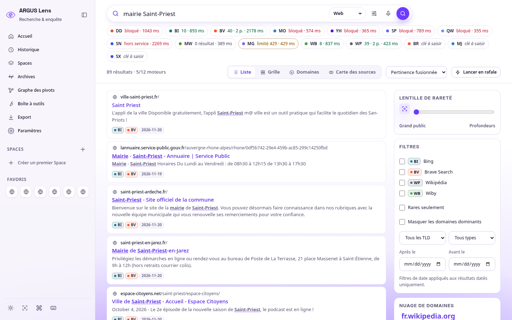
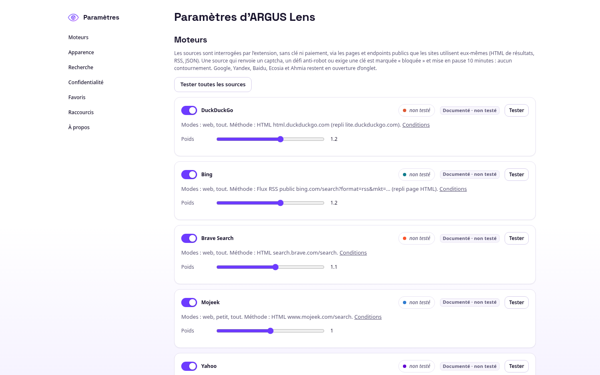
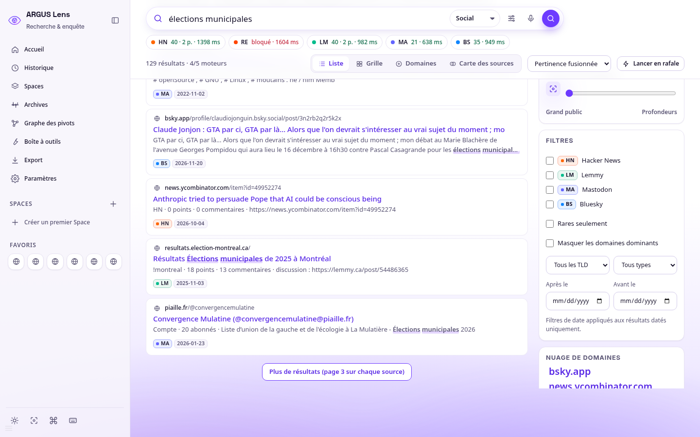
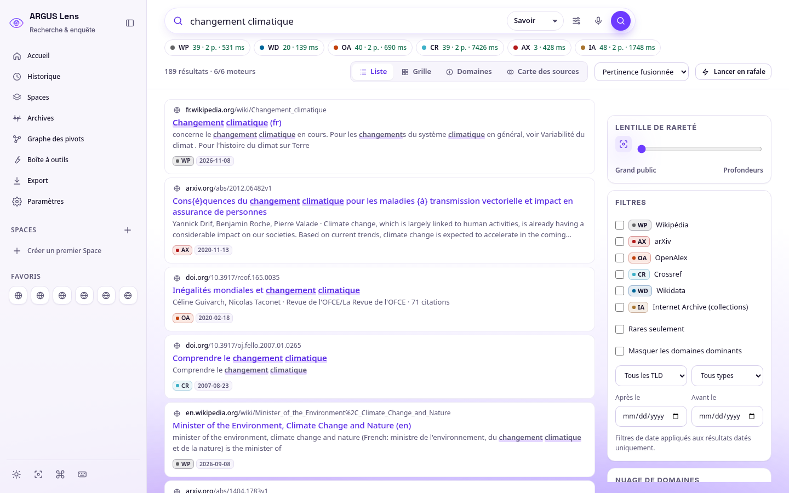
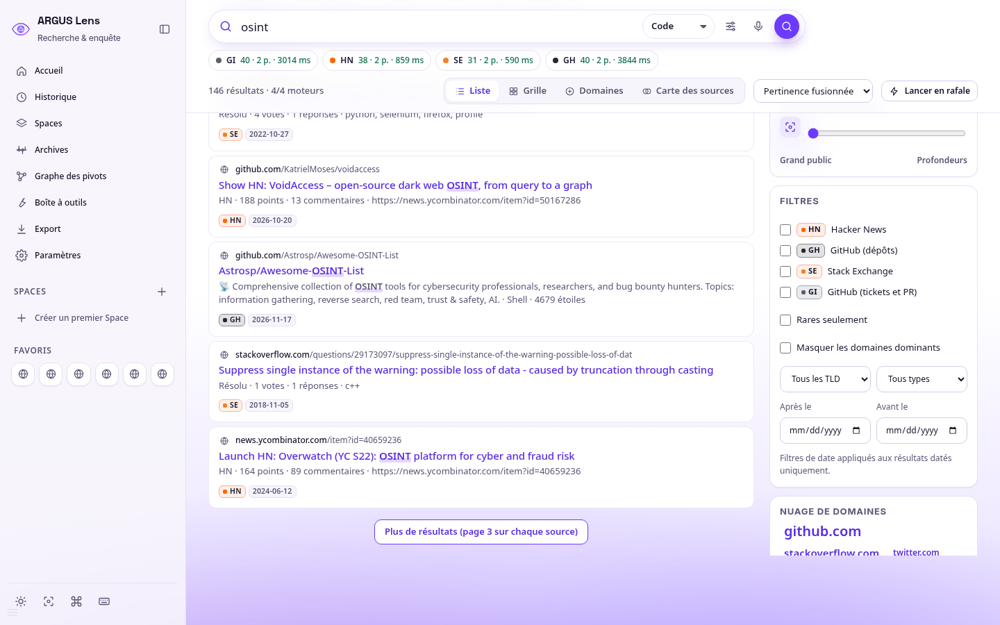

<p align="center">
  
</p>

<h1 align="center">ARGUS Lens</h1>

<p align="center">
  Extension Chrome de recherche et d'enquête en sources ouvertes.<br>
  Modes <b>Web</b>, <b>Social</b> et <b>Savoir</b>, métarecherche fusionnée sur 19 sources publiques, sans clé et sans compte.
</p>

<p align="center">
  <a href="https://github.com/Wantre/argus-lens/releases/download/v2.0.0/argus-lens-2.0.0.zip"><b>Télécharger le .zip</b></a>
  ·
  <a href="https://github.com/Wantre/argus-lens/raw/main/releases/argus-lens-2.0.0.zip">Copie dans le dépôt</a>
  ·
  <a href="https://github.com/Wantre/argus-lens/releases/latest">Versions</a>
</p>

---

ARGUS Lens est une extension Chrome (Manifest V3). Elle remplace la page « Nouvel onglet » par une barre de recherche, une métarecherche sur des sources publiques, des Spaces d'enquête, des archives Wayback, un graphe des pivots et des exports.

Version actuelle : **2.0.0** (20 novembre 2026).

SHA-256 de `releases/argus-lens-2.0.0.zip` : `3601d2ee0ba0271a65a54a763bee826da5253605946cf8970c6b0b3b45fb724d` (voir `releases/SHA256SUMS.txt`).

## Ce que la v2 ajoute

| | |
|---|---|
| **Modes** | Web, Petit web, Archives, Code, Infra, Tout voir, plus **Social** (`Alt+8`) et **Savoir** (`Alt+9`). |
| **19 sources opérationnelles** | Bing, Mwmbl, Wiby, Wikipédia FR et EN, Wikidata, OpenAlex, Crossref, arXiv, Internet Archive, GitHub (dépôts, tickets et PR), Hacker News, Stack Exchange, Lemmy, Mastodon, Bluesky, DNS over HTTPS, RDAP, Wayback CDX. |
| **Pagination** | 2 pages par source par défaut (réglable de 1 à 5), et un bouton **Plus de résultats**. |
| **Pastilles** | Pour chaque source : état, nombre de résultats, pages et latence. |
| **Cache** | Cache de session de 30 minutes. |
| **Test des sources** | Dans **Paramètres → Moteurs**, le bouton **Tester toutes les sources** montre ce qui fonctionne depuis votre connexion. |

<p align="center"></p>

## Installation (Chrome ou Edge)

L'extension n'est pas sur le Chrome Web Store : elle se charge en non empaquetée.

1. Téléchargez le zip de la [version 2.0.0](https://github.com/Wantre/argus-lens/releases/download/v2.0.0/argus-lens-2.0.0.zip) (une copie identique est aussi dans le dépôt : [`releases/argus-lens-2.0.0.zip`](https://github.com/Wantre/argus-lens/raw/main/releases/argus-lens-2.0.0.zip)) et décompressez-le dans un dossier qui restera en place, par exemple `Documents\ARGUS-Lens-2.0.0`. Après un clonage du dépôt, vous pouvez aussi pointer directement vers le dossier `extension/`.
2. Ouvrez `chrome://extensions` (Chrome 116 ou plus récent) ou `edge://extensions`.
3. Activez le **Mode développeur**.
4. Cliquez sur **Charger l'extension non empaquetée** et choisissez le dossier décompressé, celui qui contient `manifest.json`.
5. Chrome demande s'il faut conserver la page « Nouvel onglet » : choisissez **Conserver**.
6. Ouvrez **Paramètres → Moteurs → Tester toutes les sources**. Le test dure 1 à 2 minutes et montre ce qui fonctionne depuis votre connexion.

Firefox n'est pas pris en charge dans cette version.

<p align="center"></p>

## Modes Social et Savoir

<p align="center"></p>

<p align="center"></p>

<p align="center"></p>

## Sources : état constaté

Mesures du 20 novembre 2026, depuis une adresse IP de centre de données. Le résultat peut différer chez vous : utilisez **Tester toutes les sources**.

**Opérationnelles (19)** : Bing (RSS), Mwmbl, Wiby, Wikipédia FR et EN, Wikidata, OpenAlex, Crossref, arXiv, Internet Archive, GitHub dépôts, GitHub tickets et PR, Hacker News, Stack Exchange, Lemmy, Mastodon (comptes et hashtags), Bluesky, DNS over HTTPS, RDAP, Wayback CDX.

**Partielles** : Brave Search (429 après quelques requêtes), crt.sh (erreurs 502).

**Bloquées, sans contournement** : DuckDuckGo (défi anti-robot), Mojeek, Yahoo, Startpage, Qwant, SearXNG en JSON, 4get (503), Reddit (403), Common Crawl (504). Si un site répond par un captcha ou un défi, ARGUS ne contourne rien : la source est marquée « bloqué » puis mise en pause 10 minutes.

**Ouverture en onglet seulement** : Google, Yandex, Baidu, Ecosia, Ahmia.

Marginalia nécessiterait une clé personnelle gratuite, à demander auprès de ce service.

Détails des mesures : [`TESTS-v2.md`](TESTS-v2.md). Projets open source examinés : [`SOURCES-GITHUB.md`](SOURCES-GITHUB.md).

## Limites

Aucun outil ne voit « tout le Web ». ARGUS Lens fusionne les sources qui répondent réellement et affiche l'état de chacune : OK, limitée (429), délai dépassé ou hors service. Wayback CDX, crt.sh et Common Crawl sont souvent lents ou hors service. Les opérateurs qu'un moteur ne gère pas sont signalés comme ignorés, ou appliqués en filtre local.

Les données restent dans le navigateur, sans télémétrie. Toutes les requêtes partent sans cookie (`credentials: 'omit'`). Aucun code distant n'est chargé (CSP `script-src 'self'`). Les pivots e-mail et pseudonyme ne font que des recherches publiques : aucune source de fuite, aucun annuaire de données personnelles.

## Raccourcis

| Touche | Action |
|---|---|
| `Ctrl/⌘ + K` | Palette de commandes |
| `/` | Placer le curseur dans la barre de recherche |
| `Alt + 1…6`, `Alt + 8`, `Alt + 9` | Modes Web, Petit web, Archives, Code, Infra, Tout voir, puis Social et Savoir |
| `Alt + 7` | Constructeur de requête |
| `j` / `k` | Résultat suivant / précédent |
| `o` / `Maj + o` | Ouvrir le résultat au premier plan / en arrière-plan |
| `?` | Aide |

## Développement et tests

```bash
cd extension && node --test tests/*.test.js
```

75 tests unitaires, tous réussis.

## Licence

Le code et les visuels originaux sont sous licence MIT (voir `LICENSE`). Les polices Inter, Space Grotesk et JetBrains Mono sont sous SIL Open Font License 1.1 (textes dans `extension/assets/fonts/`). Les icônes sont dessinées dans le style Lucide (ISC). Les noms des moteurs et sites interrogés appartiennent à leurs propriétaires.

---

<p align="center"><sub>Conçu par <a href="https://github.com/Wantre">Wantre</a>, région lyonnaise.</sub></p>
